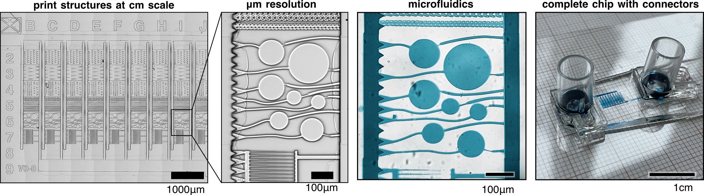
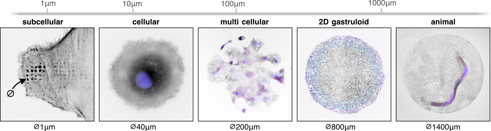
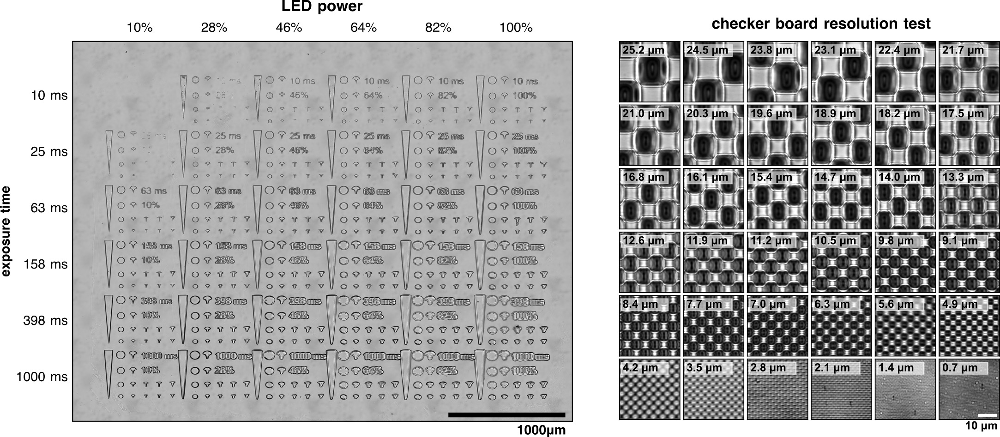
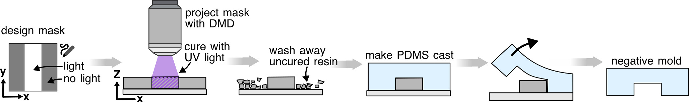

# fabscope
## 🔬 Use your microscope for microfabrication! 
Microscope with DMD projector is used to cure 3D printing resin. Based on uManager so [many hardware devices are compatible](https://micro-manager.org/Device_Support).
Using the X/Y stage of the microscope, large structures can be printed while maintaining high spatial resolution.

- `fabscope_notebook.ipynb` offers step-by-step instructions to set up and calibrate the hardware. Live preview and channel/exposure controls are provided by the [`napari-micromanager`](https://github.com/pymmcore-plus/napari-micromanager) plugin (launched from the notebook).
- `./manager/` contains helper functions to control the hardware via [`pymmcore-plus`](https://github.com/pymmcore-plus/pymmcore-plus): calibrate the DMD, upload masks, and build `useq.MDAEvent` lists for tiled acquisitions.
- `./utils/` contains helper functions to load and tile masks.

## Install

```
pip install -e .
```

Then in the notebook, point `CFG` at your Micro-Manager hardware config (e.g. `TiMoench.cfg`).

----
### Example of a microfluidic chip:

----
### We use it in cell biological research for a wide range of experiments. Examples from sub-cellular to animal scales:

----
### Single-step exposure calibration and resolution tests

----
### Overview of the workflow:

----


